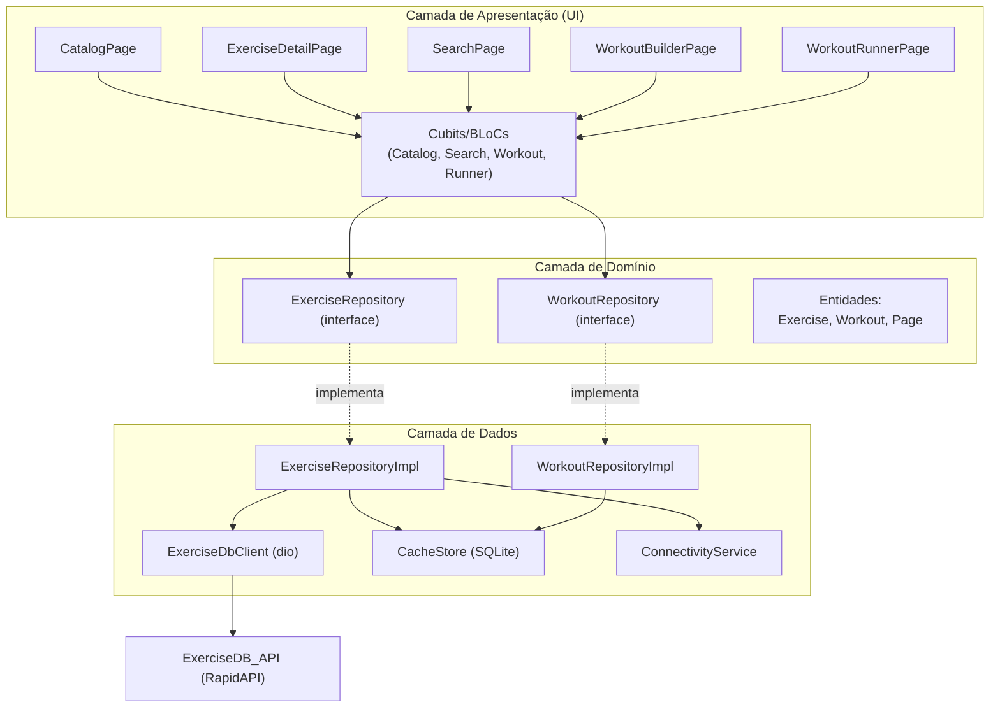
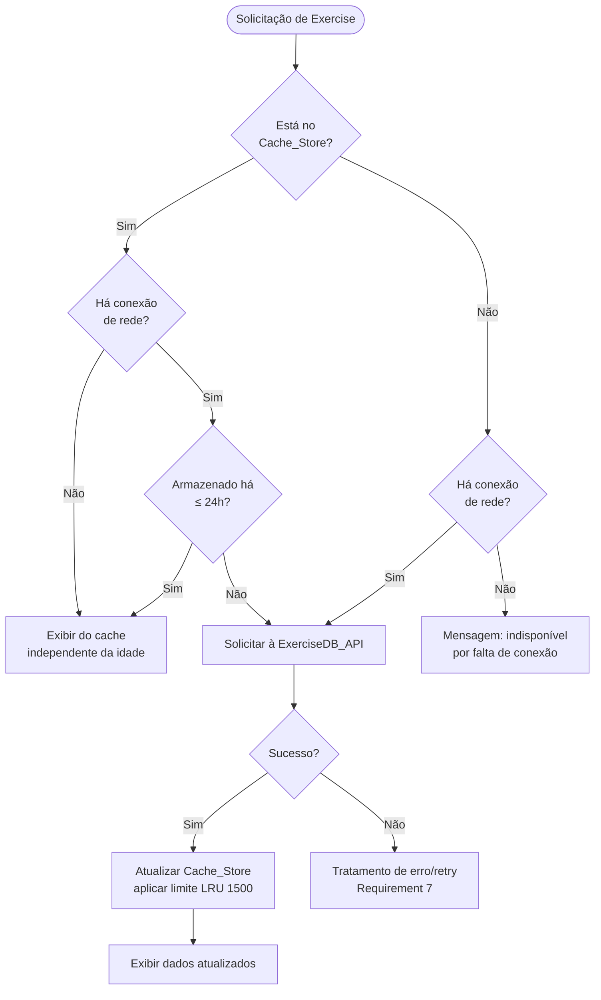

# Documento de Design

## Overview

O Gym Workout App é um aplicativo mobile multiplataforma (Android e iOS) que permite aos usuários navegar por um catálogo de exercícios, visualizar demonstrações em GIF animado, buscar exercícios por músculo/equipamento/nome, montar treinos, executar treinos de forma guiada e consumir dados de forma eficiente por meio de cache local com suporte offline. Os dados de exercícios são obtidos da **ExerciseDB_API** hospedada na RapidAPI.

### Decisões técnicas principais

| Decisão | Escolha | Justificativa |
|---|---|---|
| Framework multiplataforma | **Flutter (Dart)** | Base de código única para Android e iOS, renderização nativa de alto desempenho, suporte maduro a GIFs animados (`Image.network` + cache), e ecossistema sólido para HTTP, injeção de dependência e persistência local. |
| Camada de rede | `dio` | Suporte nativo a timeouts, interceptors (para injeção de cabeçalhos de autenticação) e política de retry configurável. |
| Cache de GIFs | `cached_network_image` | Cache em disco/memória de imagens e GIFs, com placeholder e tratamento de erro integrados. |
| Persistência local (cache de exercícios e treinos) | `sqflite` (SQLite) | Consultas estruturadas, controle de limite de registros (LRU), timestamps de expiração e persistência de treinos ordenados. |
| Gerenciamento de estado | Padrão **BLoC/Cubit** (`flutter_bloc`) | Separação clara entre UI e lógica, estados explícitos (loading/success/error) e testabilidade. |
| Configuração de segredos | `--dart-define` / arquivo de ambiente não versionado | A chave da RapidAPI não é embutida no código-fonte versionado. |

### Mapeamento de requisitos para componentes

- **Requirement 1 (catálogo + paginação)** → `CatalogPage`, `CatalogCubit`, `ExerciseRepository`, `ExerciseDbClient`.
- **Requirement 2 (detalhes + GIF)** → `ExerciseDetailPage`, `GifView`, `ExerciseRepository`.
- **Requirement 3 (busca)** → `SearchPage`, `SearchCubit`, `SearchComponent` (parte do `ExerciseRepository`).
- **Requirement 4 (montagem de treino)** → `WorkoutBuilderPage`, `WorkoutCubit`, `WorkoutRepository`.
- **Requirement 5 (execução de treino)** → `WorkoutRunnerPage`, `WorkoutRunnerCubit`.
- **Requirement 6 (cache)** → `CacheStore` (SQLite) + política de expiração/LRU no `ExerciseRepository`.
- **Requirement 7 (integração/autenticação)** → `ExerciseDbClient` + `AuthInterceptor` + `RetryInterceptor`.

## Architecture

A arquitetura segue um modelo em camadas (Clean Architecture simplificada), separando apresentação, domínio e dados. Isso isola a lógica de negócio da UI e da fonte de dados, facilitando testes e manutenção.



### Fluxo de obtenção de exercício (cache + rede + offline)

Este fluxo implementa as regras dos Requirements 6 e 7.



### Política de retry e autenticação (ExerciseDbClient)

O `ExerciseDbClient` usa dois interceptors sobre o `dio`:

1. **AuthInterceptor**: antes de cada requisição, verifica se a chave da RapidAPI está configurada. Se não estiver, aborta a requisição e sinaliza `AuthConfigurationError` (Requirement 7.2). Caso contrário, injeta os cabeçalhos `X-RapidAPI-Key` e `X-RapidAPI-Host` (Requirement 7.1).
2. **RetryInterceptor**: em caso de erro de rede, realiza até 2 novas tentativas, aguardando no máximo 3 segundos entre tentativas (Requirement 7.5). Após falha das 2 tentativas, propaga `NetworkError` (Requirement 7.6). Erros HTTP 401/403 (autenticação) e 429 (limite de requisições) **não** são retentados; são mapeados para `AuthError` e `RateLimitError` respectivamente (Requirements 7.3, 7.4).

Todas as requisições têm timeout de 10 segundos (Requirements 1.6, 3.1-3.3).

## Components and Interfaces

### Camada de Dados

#### ExerciseDbClient

Responsável por toda comunicação HTTP com a ExerciseDB_API.

```dart
abstract class ExerciseDbClient {
  /// Lista exercícios paginados. offset/limit mapeados para a paginação da API.
  /// limit padrão de página = 20 (Requirement 1.3).
  Future<List<ExerciseDto>> fetchExercises({required int offset, required int limit});

  /// Busca por nome (parcial, case-insensitive, accent-insensitive) — Requirement 3.1.
  Future<List<ExerciseDto>> fetchByName(String name);

  /// Busca por grupo muscular alvo — Requirement 3.2.
  Future<List<ExerciseDto>> fetchByBodyPart(String bodyPart);

  /// Busca por equipamento — Requirement 3.3.
  Future<List<ExerciseDto>> fetchByEquipment(String equipment);
}
```

**Endpoints da ExerciseDB_API (RapidAPI):**

| Operação | Método/Endpoint | Observações |
|---|---|---|
| Listar exercícios | `GET /exercises?limit={limit}&offset={offset}` | Paginação por offset/limit. |
| Buscar por nome | `GET /exercises/name/{name}` | Correspondência parcial. |
| Buscar por grupo muscular | `GET /exercises/bodyPart/{bodyPart}` | |
| Buscar por equipamento | `GET /exercises/equipment/{type}` | |

Cabeçalhos obrigatórios: `X-RapidAPI-Key`, `X-RapidAPI-Host`.

> Nota de pesquisa: A ExerciseDB via RapidAPI fornece mais de 1.500 exercícios com campos `id, name, bodyPart, target, equipment, gifUrl` e autenticação por cabeçalhos `X-RapidAPI-Key`/`X-RapidAPI-Host` (fontes: [ExerciseDB/exercisedb-api](https://github.com/ExerciseDB/exercisedb-api), [exercise-api-free tutorial](https://github.com/furkanuruk/exercise-api-free/blob/main/docs/tutorial.md)). Conteúdo reformulado para conformidade de licenciamento.

#### CacheStore

Abstração sobre o SQLite para cache de exercícios e persistência de treinos.

```dart
abstract class CacheStore {
  // --- Exercícios ---
  Future<CachedExercise?> getExercise(String id);
  Future<List<CachedExercise>> getAllExercises();
  Future<void> upsertExercise(Exercise exercise, DateTime storedAt);
  Future<void> touchExercise(String id, DateTime accessedAt); // atualiza last-access p/ LRU
  Future<int> countExercises();
  Future<void> evictLeastRecentlyAccessed(int howMany); // mantém limite de 1500

  // --- Treinos ---
  Future<void> saveWorkout(Workout workout);
  Future<List<Workout>> getWorkouts();
  Future<Workout?> getWorkout(String id);
}
```

#### ConnectivityService

```dart
abstract class ConnectivityService {
  Future<bool> isOnline();
  Stream<bool> onConnectivityChanged();
}
```

### Camada de Domínio

#### ExerciseRepository

Orquestra cache, rede e conectividade. Centraliza as regras dos Requirements 1, 3, 6 e 7.

```dart
abstract class ExerciseRepository {
  /// Requirement 1: página de no máximo 20 exercícios.
  Future<ExercisePage> getCatalogPage({required int page});

  /// Requirement 2/6: obtém um exercício aplicando política de cache.
  Future<Exercise> getExercise(String id);

  /// Requirement 3: buscas (aplicam cache/rede conforme conectividade).
  Future<List<Exercise>> searchByName(String term);
  Future<List<Exercise>> searchByBodyPart(String bodyPart);
  Future<List<Exercise>> searchByEquipment(String equipment);
}
```

#### WorkoutRepository

```dart
abstract class WorkoutRepository {
  /// Requirement 4: persiste um treino validado.
  Future<void> save(Workout workout);
  Future<List<Workout>> getAll();
  Future<Workout?> getById(String id);
}
```

### Camada de Apresentação

- **CatalogCubit**: estados `CatalogLoading`, `CatalogLoaded(List<Exercise> items, int page, bool hasMore)`, `CatalogError(message, retryable)`. Implementa scroll infinito (Requirements 1.3–1.5) e retry (Requirements 1.6–1.7).
- **ExerciseDetailCubit**: estados para carregamento de detalhes e estado do GIF (`GifLoading`, `GifPlaying`, `GifUnavailable`) — Requirement 2.
- **SearchCubit**: mantém critérios de busca, aplica debounce, trata resultado vazio (Requirement 3.4), limpeza de filtros (Requirement 3.5) e erro preservando critérios (Requirement 3.6).
- **WorkoutBuilderCubit**: gerencia a lista ordenada em edição (adicionar/remover/validar/salvar) — Requirement 4.
- **WorkoutRunnerCubit**: mantém o índice atual, navegação anterior/próximo, tela de conclusão — Requirement 5.

### Mapeamento de erros

| Condição | Tipo de erro de domínio | Requisito | Tratamento na UI |
|---|---|---|---|
| Timeout (10s) na lista | `TimeoutError` | 1.6 | Mensagem + botão "Tentar novamente" |
| Chave RapidAPI ausente | `AuthConfigurationError` | 7.2 | Mensagem de falha de configuração |
| HTTP 401/403 | `AuthError` | 7.3 | Mensagem de falha de autenticação; tela inalterada |
| HTTP 429 | `RateLimitError` | 7.4 | Mensagem de limite atingido; dados preservados |
| Falha de rede após 2 retries | `NetworkError` | 7.6 | Mensagem de falha de comunicação + "Tentar novamente" |
| Offline + exercício ausente | `OfflineUnavailableError` | 6.5 | Mensagem de indisponibilidade por falta de conexão |
| Falha ao persistir treino | `PersistenceError` | 4.7 | Mantém treino em edição; mensagem de falha ao salvar |

## Data Models

### Exercise (entidade de domínio)

```dart
class Exercise {
  final String id;          // identificador único
  final String name;        // nome do exercício
  final String bodyPart;    // grupo muscular / região corporal
  final String target;      // músculo alvo
  final String equipment;   // equipamento necessário
  final String gifUrl;      // URL do GIF animado de demonstração
}
```

### CachedExercise (modelo de persistência)

```dart
class CachedExercise {
  final Exercise exercise;
  final DateTime storedAt;    // quando foi obtido da API (expiração 24h — Req 6.2/6.3)
  final DateTime accessedAt;  // último acesso (ordenação LRU — Req 6.1)
}
```

### Workout (entidade de domínio)

```dart
class Workout {
  final String id;
  final String name;                 // 1..60 caracteres, trim aplicado (Req 4.4)
  final List<Exercise> exercises;    // ordenado; 1..50 itens (Req 4.3)
  final DateTime savedAt;
}
```

Regras de domínio associadas:
- `name` normalizado com `trim()`; inválido se vazio após trim ou > 60 caracteres (Reqs 4.4, 4.6).
- `exercises` deve conter entre 1 e 50 itens para salvar (Reqs 4.3, 4.5).
- A ordem dos exercícios é significativa e contígua (sem lacunas) após remoções (Req 4.2).

### ExercisePage (resultado paginado)

```dart
class ExercisePage {
  final List<Exercise> items; // no máximo 20 (Req 1.3)
  final int page;             // índice de página (0-based)
  final bool hasMore;         // indica existência de próxima página (Reqs 1.4, 1.5)
}
```

### Esquema do banco SQLite (Cache_Store)

```sql
CREATE TABLE exercises (
  id          TEXT PRIMARY KEY,
  name        TEXT NOT NULL,
  body_part   TEXT NOT NULL,
  target      TEXT NOT NULL,
  equipment   TEXT NOT NULL,
  gif_url     TEXT NOT NULL,
  stored_at   INTEGER NOT NULL,  -- epoch ms
  accessed_at INTEGER NOT NULL   -- epoch ms (LRU)
);
CREATE INDEX idx_exercises_accessed_at ON exercises(accessed_at);

CREATE TABLE workouts (
  id       TEXT PRIMARY KEY,
  name     TEXT NOT NULL,
  saved_at INTEGER NOT NULL
);

CREATE TABLE workout_exercises (
  workout_id  TEXT NOT NULL REFERENCES workouts(id) ON DELETE CASCADE,
  position    INTEGER NOT NULL,  -- ordem contígua 0..n-1
  exercise_id TEXT NOT NULL,
  PRIMARY KEY (workout_id, position)
);
```

### Normalização de busca por nome

Para atender o Requirement 3.1 (parcial, case-insensitive e accent-insensitive), o termo e os nomes são normalizados antes da comparação local de fallback:

```dart
String normalize(String s) =>
    removeDiacritics(s.toLowerCase().trim());
// "Supino Inclinado" e "supino inclinado" e "SÚPINO" → comparáveis
```

## Correctness Properties

*Uma propriedade é uma característica ou comportamento que deve ser verdadeiro em todas as execuções válidas de um sistema — essencialmente, uma afirmação formal sobre o que o sistema deve fazer. Propriedades servem de ponte entre especificações legíveis por humanos e garantias de correção verificáveis por máquina.*

As propriedades abaixo foram derivadas da análise de prework dos critérios de aceitação. Propriedades logicamente redundantes foram consolidadas para que cada propriedade forneça valor de validação único.

### Property 1: Paginação produz páginas de no máximo 20 itens cobrindo toda a lista

*Para qualquer* lista de exercícios de tamanho N, a paginação produz páginas contendo no máximo 20 itens cada; a concatenação ordenada de todas as páginas reconstitui exatamente a lista original (sem duplicações nem omissões); e `hasMore` é verdadeiro se, e somente se, existir pelo menos uma página subsequente não vazia.

**Validates: Requirements 1.3, 1.4, 1.5**

### Property 2: Busca por nome é parcial, insensível a maiúsculas e a acentos

*Para qualquer* conjunto de exercícios e termo de busca com ao menos 2 caracteres, o resultado da busca por nome contém exatamente os exercícios cujo nome normalizado (minúsculas, sem acentos, com trim) inclui o termo normalizado como subcadeia, e nenhum exercício fora desse critério.

**Validates: Requirements 3.1**

### Property 3: Filtro por campo retorna o subconjunto correto e completo

*Para qualquer* conjunto de exercícios e valor de filtro aplicado a um campo (grupo muscular alvo ou equipamento), o resultado contém todos os exercícios cujo campo é igual ao valor filtrado e somente esses.

**Validates: Requirements 3.2, 3.3**

### Property 4: Limpar busca e filtros restaura o catálogo completo

*Para qualquer* sequência de buscas ou aplicação de filtros, limpar o termo e os filtros retorna o estado de apresentação ao catálogo completo equivalente ao estado inicial anterior a qualquer busca.

**Validates: Requirements 3.5**

### Property 5: Detalhes do exercício contêm todos os campos exigidos

*Para qualquer* Exercise, o modelo de apresentação da tela de detalhes inclui o nome, o grupo muscular alvo, o equipamento necessário e uma referência à área de demonstração do GIF do exercício.

**Validates: Requirements 2.1**

### Property 6: Adicionar exercício insere ao final preservando a ordem existente

*Para qualquer* Workout e qualquer Exercise, adicionar o exercício resulta em uma lista cujo tamanho é maior em um, cujo último elemento é o exercício adicionado e cujo prefixo é idêntico à lista original.

**Validates: Requirements 4.1**

### Property 7: Remover exercício mantém ordem contígua sem lacunas

*Para qualquer* Workout não vazio e qualquer posição válida, remover o exercício daquela posição resulta em posições contíguas de 0 a n-2 e preserva a ordem relativa dos exercícios remanescentes.

**Validates: Requirements 4.2**

### Property 8: Persistência de treino é um round-trip fiel

*Para qualquer* Workout válido (nome com 1 a 60 caracteres após trim e de 1 a 50 exercícios), salvá-lo no armazenamento local e recarregá-lo reconstitui um Workout com o mesmo nome e a mesma sequência ordenada de exercícios.

**Validates: Requirements 4.3**

### Property 9: Validação de salvamento aceita somente nome e quantidade válidos

*Para qualquer* Workout candidato, o salvamento é aceito se, e somente se, o nome possuir entre 1 e 60 caracteres após remover espaços em branco das extremidades E a quantidade de exercícios estiver entre 1 e 50; quando aceito, o nome persistido é exatamente o nome com trim aplicado.

**Validates: Requirements 4.4, 4.5, 4.6**

### Property 10: Estado inicial da execução aponta para o primeiro exercício

*Para qualquer* Workout não vazio, iniciar a execução posiciona no índice 0, exibe o primeiro exercício na ordem e indica a posição "1 de N", onde N é o total de exercícios.

**Validates: Requirements 5.1**

### Property 11: Navegação avançar/voltar é consistente e é round-trip na posição

*Para qualquer* Workout e posição atual k, avançar quando k < N-1 leva à posição k+1 exibindo exercises[k+1], voltar quando k > 0 leva à posição k-1 exibindo exercises[k-1], e avançar seguido de voltar (quando ambos são permitidos) retorna à posição k.

**Validates: Requirements 5.2, 5.4**

### Property 12: Ação de voltar é desabilitada apenas no primeiro exercício

*Para qualquer* Workout em execução, a ação de retornar ao exercício anterior está desabilitada se, e somente se, a posição atual for o índice 0.

**Validates: Requirements 5.3**

### Property 13: Avançar a partir do último exercício conclui o treino

*Para qualquer* Workout não vazio, estando na última posição (N-1), avançar transiciona o runner para o estado de conclusão do treino.

**Validates: Requirements 5.5**

### Property 14: O cache respeita o limite de 1500 com remoção LRU

*Para qualquer* sequência de inserções e acessos de exercícios, a quantidade de exercícios no Cache_Store nunca excede 1.500 e, sempre que o limite é ultrapassado, os exercícios removidos são exatamente aqueles com o menor tempo de último acesso (acessados há mais tempo).

**Validates: Requirements 6.1**

### Property 15: A resolução da origem dos dados respeita expiração e conectividade

*Para qualquer* exercício presente no cache, a decisão de origem é: quando offline, servir do cache independentemente da idade; quando online e armazenado há 24 horas ou menos, servir do cache sem chamar a API; quando online e armazenado há mais de 24 horas, chamar a ExerciseDB_API e, após sucesso, atualizar o registro no cache (renovando o instante de armazenamento).

**Validates: Requirements 6.2, 6.3, 6.4**

### Property 16: Offline sem cache sinaliza indisponibilidade preservando o cache

*Para qualquer* solicitação de exercício ausente no cache enquanto o dispositivo está offline, o resultado é um erro de indisponibilidade por falta de conexão e a quantidade e o conteúdo do Cache_Store permanecem inalterados.

**Validates: Requirements 6.5**

### Property 17: Toda requisição à API inclui os cabeçalhos de autenticação da RapidAPI

*Para qualquer* requisição construída pelo ExerciseDbClient com a chave configurada, os cabeçalhos `X-RapidAPI-Key` e `X-RapidAPI-Host` estão presentes com os valores configurados.

**Validates: Requirements 7.1**

### Property 18: Ausência de chave aborta a requisição com falha de configuração

*Para qualquer* tentativa de requisição quando a chave da RapidAPI não está configurada, nenhuma requisição é enviada à rede e o resultado é uma falha de configuração de autenticação; quando a chave está configurada, a requisição prossegue.

**Validates: Requirements 7.2**

### Property 19: Falha de rede dispara no máximo 2 novas tentativas e propaga erro de comunicação

*Para qualquer* requisição que falha persistentemente por erro de rede, o ExerciseDbClient realiza exatamente 3 chamadas no total (1 original mais 2 novas tentativas), com intervalo não superior a 3 segundos entre tentativas, e o resultado final é um erro de falha de comunicação com opção de nova tentativa.

**Validates: Requirements 7.5, 7.6**

## Error Handling

O tratamento de erros é centralizado nos repositórios, que mapeiam falhas de infraestrutura para tipos de erro de domínio consumidos pelos Cubits e exibidos de forma consistente na UI.

### Hierarquia de erros de domínio

```dart
sealed class AppFailure {}
class TimeoutError           extends AppFailure {} // Req 1.6
class AuthConfigurationError extends AppFailure {} // Req 7.2
class AuthError              extends AppFailure {} // Req 7.3
class RateLimitError         extends AppFailure {} // Req 7.4
class NetworkError           extends AppFailure {} // Req 7.6
class OfflineUnavailableError extends AppFailure {} // Req 6.5
class PersistenceError       extends AppFailure {} // Req 4.7
```

### Estratégias por categoria

- **Timeout (10s)** — Todas as chamadas de rede usam timeout de 10 segundos. Ao expirar, o carregamento é interrompido e a UI apresenta mensagem de erro com ação "Tentar novamente" (Requirements 1.6, 1.7, 3.6).
- **Autenticação não configurada** — O `AuthInterceptor` verifica a presença da chave antes de enviar; se ausente, aborta e retorna `AuthConfigurationError` sem tráfego de rede (Requirement 7.2).
- **Erros de autenticação da API (401/403)** — Mapeados para `AuthError`. A UI exibe mensagem de falha de autenticação e mantém os dados já exibidos sem alteração (Requirement 7.3).
- **Limite de requisições (429)** — Mapeado para `RateLimitError`. A UI informa que o limite foi atingido, orienta tentar mais tarde e preserva os dados em tela (Requirement 7.4).
- **Erros de rede** — O `RetryInterceptor` tenta novamente até 2 vezes (intervalo ≤ 3s). Esgotadas as tentativas, propaga `NetworkError`; a UI exibe falha de comunicação com opção de retry (Requirements 7.5, 7.6).
- **Offline sem cache** — Quando offline e o exercício não está em cache, retorna `OfflineUnavailableError` sem modificar o cache (Requirement 6.5).
- **Falha de GIF** — Falhas de carregamento de GIF (catálogo, detalhes, execução) exibem placeholder e mensagem de indisponibilidade, preservando textos e mantendo a navegação (Requirements 2.4, 5.6).
- **Falha de persistência de treino** — `PersistenceError` mantém o treino em edição intacto e exibe mensagem de falha ao salvar (Requirement 4.7).
- **Validação de treino** — Erros de validação (sem exercícios, nome inválido) não geram chamadas externas; impedem o salvamento, preservam o estado em edição e exibem mensagens orientativas (Requirements 4.5, 4.6).

## Testing Strategy

A estratégia combina testes unitários/baseados em exemplos, testes baseados em propriedades (PBT) e testes de widget/integração, cobrindo tanto exemplos concretos quanto propriedades universais.

### Abordagem dupla

- **Testes unitários e de exemplo**: casos concretos, estados de UI (loading/empty/error), mapeamento de status HTTP, casos de borda e tratamento de erro.
- **Testes de propriedade (PBT)**: validam as propriedades universais da seção Correctness Properties sobre uma ampla gama de entradas geradas.
- **Testes de widget**: renderização de catálogo, detalhes, placeholders de GIF e indicadores de carregamento.

### Property-Based Testing

- Biblioteca: **`fast_check` para Dart não é padrão**; utiliza-se o pacote de PBT da comunidade Dart/Flutter (ex.: `glados`), que oferece geradores e encolhimento (shrinking). PBT **não** será implementado do zero.
- Cada propriedade da seção Correctness Properties é implementada por **um único teste de propriedade**.
- Cada teste de propriedade executa no mínimo **100 iterações**.
- Cada teste de propriedade referencia sua propriedade de design por meio de um comentário com a tag:
  - Formato: **Feature: gym-workout-app, Property {número}: {texto da propriedade}**
- Geradores cobrem casos de borda exigidos pelos critérios: nomes com acentos e variação de caixa, strings compostas apenas de espaços, listas vazias e no limite (0, 1, 20, 50, 1500 itens), idades de cache em torno do limite de 24h (abaixo, igual e acima) e estados de conectividade online/offline.

#### Mapeamento propriedade → alvo de teste

| Propriedade | Alvo testado |
|---|---|
| 1 | Função de paginação do catálogo |
| 2 | Matcher de busca por nome normalizado |
| 3 | Filtros por `bodyPart` e `equipment` |
| 4 | Transição de estado "limpar busca" do SearchCubit |
| 5 | View-model de detalhes do exercício |
| 6, 7 | Operações add/remove do WorkoutBuilderCubit |
| 8 | Round-trip de persistência no CacheStore (SQLite em memória) |
| 9 | Validador de salvamento de treino |
| 10, 11, 12, 13 | WorkoutRunnerCubit (posição e navegação) |
| 14, 15, 16 | Política de cache do ExerciseRepository (com fakes de store/conectividade) |
| 17, 18 | AuthInterceptor |
| 19 | RetryInterceptor (com transporte HTTP mockado e relógio/temporizador falso) |

### Testes de exemplo e edge case

- **Estados de UI** (Requirements 1.2, 3.4): loading durante requisição pendente; mensagem de "nenhum exercício encontrado".
- **Timeout e retry de UI** (Requirements 1.6, 1.7, 3.6): mock que excede 10s; verificação do estado de erro e reenvio no retry, preservando critérios de busca.
- **GIF** (Requirements 2.2, 2.3, 2.4, 5.6): início de carregamento ao montar, configuração de loop e placeholder com textos preservados em caso de falha.
- **Mapeamento de status** (Requirements 7.3, 7.4): respostas 401/403 → `AuthError`; 429 → `RateLimitError`, com preservação dos dados em tela.
- **Persistência com falha** (Requirement 4.7): store que lança exceção; treino em edição preservado.

### Testes de integração

- Fluxo cache→rede→offline do `ExerciseRepository` com `ConnectivityService` e `CacheStore` reais (SQLite em memória) e `ExerciseDbClient` mockado, validando a resolução de origem de ponta a ponta.
- Requisições reais à ExerciseDB_API ficam restritas a um pequeno conjunto de testes de contrato opcionais (1–2 exemplos), executados somente quando a chave está disponível, para confirmar a forma da resposta e o funcionamento dos cabeçalhos de autenticação.

### Testes de desempenho (verificação manual/instrumentada)

Os limites temporais (detalhes em ≤ 2s — Req 2.1; início de GIF em ≤ 10s — Req 2.2) são verificados por medições instrumentadas em dispositivo/emulador, não por PBT.
